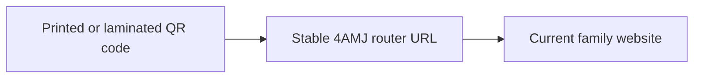

# 4AMJ — QR Code Router

4AMJ provides a stable web address for QR codes used on Whiteley family materials. Visitors scan a code, open the router, and are forwarded to the current family website.

The router lets you **print, laminate, and distribute the QR code, then maintain its destination in one place.** If the website moves to a different URL or hosting provider, update the router while keeping the address encoded in the QR code unchanged.

## Why use a router?

QR codes printed on signs, handouts, or laminated cards can remain in circulation long after they are produced. A router separates those physical materials from the website's current location:

- **Preserve printed materials.** Codes that point to the router can continue to work after a destination change, without reprinting, relaminating, or redistributing them.
- **Centralize updates.** One redirect change updates the destination for every copy of the same QR code.
- **Support future moves.** The family website can move between projects or hosting providers while retaining a consistent entry point for visitors.

This depends on preserving the router URL and keeping its GitHub Pages publication available. The benefit applies to QR codes that encode the router address.

## Routing

| Address | URL |
| --- | --- |
| **Encode in the QR code** | [https://joeywilkes12.github.io/4AMJ/](https://joeywilkes12.github.io/4AMJ/) |
| Current destination website | [https://whiteley-website.replit.app/](https://whiteley-website.replit.app/) |

The router address stays the same when the destination changes. The destination website can be maintained and hosted independently of this repository.

## Implementation

The router is a small static HTML page with three paths to the same destination:

- A **meta refresh** forwards the browser to the destination.
- **JavaScript** uses `window.location.replace(...)` to navigate without adding the router page to browser history.
- A **manual link** lets visitors continue if automatic navigation does not occur.

No application backend, database, dependency installation, or build step is required.

## Deployment

GitHub Pages publishes this repository with the following configuration:

| Setting | Value |
| --- | --- |
| Publishing branch | `joeywilkes12-4amj-landing-page-01` |
| Publishing folder | `/` (repository root) |
| Live router file | [Published branch's index.html](https://github.com/JoeyWilkes12/4AMJ/blob/joeywilkes12-4amj-landing-page-01/index.html) |

The repository's default branch is `main`, which displays this README on GitHub. The live router uses the publishing branch listed above; editing `index.html` on `main` alone does not update the public redirect.

## Changing the destination

1. Confirm the replacement website is published and accessible at its new URL.
2. Create a branch from `joeywilkes12-4amj-landing-page-01` and update the destination URL in all three places in its root `index.html`: the meta refresh, `window.location.replace(...)`, and the fallback link.
3. Open a pull request against `joeywilkes12-4amj-landing-page-01` for review and merge.
4. After GitHub Pages finishes deploying, open the router URL and scan a printed QR code to verify that both reach the new website.
5. Update the current destination recorded in this README on `main`.

Keep the encoded router URL unchanged throughout this process. Existing printed and laminated copies can then continue directing visitors to the current website.
